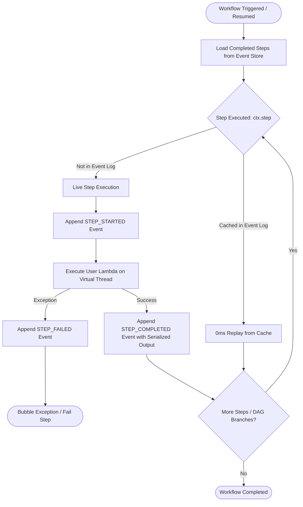
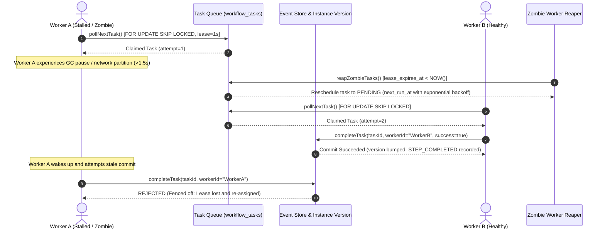

# Lazarus — Distributed Durable Workflow Engine (Java 24)

[](https://github.com/gopichand-1423/lazarus-workflow-engine/actions)
[](https://openjdk.org/projects/jdk/24/)
[](https://openjdk.org/jeps/491)
[](https://www.postgresql.org/)
[](LICENSE)

**Lazarus** is a lightweight, fault-tolerant, event-sourced durable execution engine built from scratch in **Java 24**. It enables developers to write standard imperative Java code that is impervious to application crashes, network timeouts, and hardware failures. 

When a workflow process crashes mid-execution, Lazarus recovers its exact state upon restart and deterministically replays previously completed steps in **0ms** without re-executing non-idempotent side effects (e.g., credit card charges or external API calls).

---

## Architecture Overview

### 1. Workflow Replay & State Machine
Lazarus treats the append-only event store (`workflow_events`) as the single source of truth. Each durable step queries an in-memory replay cache loaded during workflow context initialization:



---

### 2. Distributed Task Queue & Split-Brain Zombie Fencing
Lazarus implements lease-based task orchestration with optimistic version concurrency. Expired leases are reclaimed by a background reaper, fencing out stalled zombie workers from committing duplicate side effects:



---

## Technical Highlights

### Java 24 Virtual Threads & JEP 491
- Built natively for **JDK 24**, leveraging [JEP 491: Synchronize Virtual Threads without Pinning](https://openjdk.org/jeps/491).
- Workflow branches, HTTP endpoints, and task pollers run on lightweight Virtual Threads (`Executors.newVirtualThreadPerTaskExecutor()`), enabling thousands of concurrent durable workflows without platform thread exhaustion.

### Concurrency & Queue Mechanics (`FOR UPDATE SKIP LOCKED`)
- High-throughput task dispatching using PostgreSQL/H2 `FOR UPDATE SKIP LOCKED`.
- Worker threads claim tasks concurrently without lock contention or table serialization bottlenecks.

### Optimistic Concurrency Control (OCC)
- Workflow execution records use a monotonically increasing `current_version` counter in `workflow_instances`.
- Version bumps serialize event appends atomically within single-database transactions.

### Deterministic Parallel DAG Fan-Out / Fan-In
- The `ctx.parallel(Class<T> type, Map<String, Callable<T>> branches)` construct executes concurrent DAG branches across Virtual Threads.
- If a crash occurs during a fan-out, branches that previously succeeded are replayed from cache in 0ms, while only the pending or failed branch re-executes.

### Dual-Engine Database Compatibility
- Fully optimized for production **PostgreSQL 16+** (native `JSONB`, `INTERVAL`, `ON CONFLICT`, `BIGSERIAL`).
- Automatic transparent fallback to in-memory **H2 (PostgreSQL Mode)** when port 5432 is unavailable, allowing testing and local development without requiring external daemons.

---

## Getting Started

### Prerequisites
- **JDK 24** (e.g., via `.java-env\jdk-24` or system installed)
- **Apache Maven 3.9+**

### 1. Environment Activation
Activate the isolated Java 24 environment:
```powershell
. .\activate.ps1
```

### 2. Run the Deterministic Simulation Testing (DST) Harness
Verifies split-brain fencing, lease timeouts, crash recovery, and replay idempotency:
```powershell
mvn compile exec:java -Dexec.mainClass="dev.lazarus.dst.LazarusSimulationRunner"
```

### 3. Run the Real-Time Control Plane Dashboard Server
Starts the embedded Java 24 Virtual Thread HTTP Server and Real-Time Event Sourcing Inspector:
```powershell
mvn compile exec:java -Dexec.mainClass="dev.lazarus.ui.LazarusDashboardServer"
```
Open **[http://localhost:8080](http://localhost:8080)** in your browser to:
- Trigger fault-injected parallel workflows (`crash=true`).
- Trigger deterministic recovery and replay (`crash=false`).
- Inspect the live, real-time audit trail of `workflow_events`.

### 4. Run the Full Unit Test & High-Concurrency Benchmark Suite
Executes the comprehensive JUnit 5 test suite (200 concurrent workflows / 400 durable steps):
```powershell
mvn test
```

---

## Project Structure

```
LAZARUS/
├── src/
│   ├── main/
│   │   ├── java/dev/lazarus/
│   │   │   ├── dst/
│   │   │   │   ├── DeterministicChaosClock.java
│   │   │   │   └── LazarusSimulationRunner.java    # DST harness
│   │   │   ├── engine/
│   │   │   │   ├── LazarusEngine.java              # Virtual Thread executor engine
│   │   │   │   └── WorkflowContext.java            # Step execution & parallel DAG
│   │   │   ├── store/
│   │   │   │   ├── EventStoreRepository.java       # Append-only event store
│   │   │   │   └── TaskQueueRepository.java        # Lease queue & reaper
│   │   │   └── ui/
│   │   │       └── LazarusDashboardServer.java     # Embedded HTTP UI on JDK 24
│   │   ├── proto/
│   │   │   └── lazarus.proto                       # gRPC interface definitions
│   │   └── resources/
│   │       └── schema.sql                          # Database schema DDL
│   └── test/
│       └── java/dev/lazarus/
│           └── LazarusEngineTest.java              # JUnit 5 test & benchmark suite
├── activate.ps1                                    # Java 24 environment script
├── docker-compose.yml                              # PostgreSQL container specification
├── pom.xml                                         # Maven dependencies & build configuration
└── README.md                                       # Documentation & architecture guide
```

---

## License
Licensed under the [Apache License, Version 2.0](LICENSE). Copyright (c) 2026 Gopichand Vallamdas.
